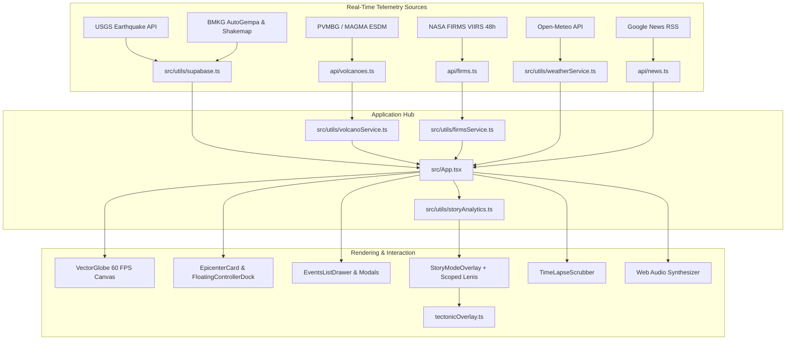

<div align="center">

# Nusantara Crustal Observatory & Global Seismic Tracker

**Real-Time Seismic Telemetry, NASA FIRMS Wildfire Satellite Intelligence, Volcanic Observatory & Cartographic Story Mode**

[](https://react.dev/)
[](https://www.typescriptlang.org/)
[](https://developer.mozilla.org/en-US/docs/Web/API/Canvas_API)
[](https://vitejs.dev/)
[](https://tailwindcss.com/)
[](https://lenis.darkroom.engineering/)
[](https://supabase.com/)

A high-performance multi-hazard monitoring observatory built for the Indonesian Archipelago (`94°E to 142°E`, `12°S to 7°N`). Combines 60 FPS HTML5 Canvas planar vector cartography, live USGS and BMKG earthquake feeds, NASA FIRMS VIIRS thermal satellite anomalies, PVMBG (MAGMA Indonesia) volcanic advisories, 7-day 4D time-lapse replay, and an isolated dual-mode Tectonic Story Expedition.

</div>

---

## Overview

**Nusantara Crustal Observatory / Global Seismic Tracker** translates live geoscientific feeds into a responsive interactive observatory with real-time agency telemetry and zero mock event fallbacks. Built on **React 19**, **HTML5 Canvas 2D**, **Tailwind CSS v4**, and **Vite**, the workspace operates directly as a fullscreen live map while keeping editorial storytelling one toggle away:

- **Nusantara Vector Map Engine:** Hardware-accelerated 2D canvas projection (`VectorGlobe.tsx`) with offscreen landmass caching, coordinate graticules, Sunda Trench trace, kinetic drag panning, wheel zoom, and mobile two-finger pinch zoom.
- **Dual-Mode Tectonic Story Expedition:** Optional fullscreen Swiss editorial mode (`StoryModeOverlay.tsx`) powered by scoped `Lenis` (`^1.3.27`) with `lenis/snap` stage locking. Traverses 6 synchronized stages (Prologue, Sunda Megathrust, Palu-Koro Fault, Deep Banda Arc, Papua Collision Belt, Epilogue) with automated camera fly-to framing, 60 FPS canvas fault vector overlays (`tectonicOverlay.ts`), and live corridor event counts.
- **Seismic Telemetry (BMKG & USGS):** Direct AutoGempa bulletins, desktop bathymetry radar card / mobile Dynamic Island bottom sheet (`EpicenterMapCard.tsx`), official BMKG shakemaps, Modified Mercalli Intensity (MMI) estimates, P/S wave ETA estimation, and sonar pulse markers.
- **NASA FIRMS Wildfire Satellite Relay:** Vercel Edge proxy (`api/firms.ts`) polling NASA VIIRS NOAA-20 / SNPP 48-hour anomalies, prioritizing up to 1,200 hotspots by Fire Radiative Power (MW) and recency alongside regional Open-Meteo wind dispersion vectors.
- **Volcanic Observatory (PVMBG / MAGMA Indonesia):** Monitors active Indonesian volcanoes (`src/data/volcanoes.ts` and `api/volcanoes.ts`) including Lewotobi Laki-Laki, Anak Krakatau, Merapi, Semeru, Ibu, Marapi, and Ruang with Haversine geodesic distance calculation (`geoProximity.ts`) and ash plume direction tracking.
- **Disaster Verification & Alert Utilities:** Live Google News RSS relay (`api/news.ts`), 7-day 4D chronological playback scrubber (`TimeLapseScrubber.tsx`), synthesized Web Audio alert pings, social emergency infographic generator, WhatsApp bulletin formatting, and local bookmark persistence.
- **Full Bilingual Support (ID / EN):** Real-time localization across all HUD elements, telemetry modals, and story expedition stages (`src/utils/i18n.ts`).

---

## Key Features

### 1. Planar Vector Cartography (`VectorGlobe.tsx`)
- Projects GeoJSON island polygons (`public/data/indonesia_islands.json`) and neighboring landmass boundaries (`public/data/world_countries_110m.json`) into an offscreen cache canvas keyed by viewport dimensions, DPR, zoom, pan, and center offset ratios.
- Renders real-time seismic markers color-coded by magnitude or hypocenter depth, diamond thermal anomalies graded by FRP (MW), and alert triangles for active volcanoes.
- Automatically adapts desktop/mobile viewport framing ratios when Story Mode transitions between tectonic corridors without re-mounting the canvas.

### 2. Dual-Mode Story Expedition (Scoped Lenis + Snap)
- Accessible directly from the header navbar (`EKSPEDISI` / `STORY`) without obstructing initial access to the live observatory map.
- Scoped `Lenis` scroll wrapper isolates wheel and touch momentum inside the Story overlay (`overflow-hidden` remains active on the base dashboard viewport so mobile map gestures never scroll the browser body).
- Features a typographic Prologue (`StoryPrologStage.tsx`), four focal-datum geological monographs (`StoryChapterCard.tsx`), a vertical architectural survey ruler (`StoryProgressRail.tsx`), and real-time tectonic overlays (`tectonicOverlay.ts`) animating subduction barbs, sinistral shear arrows, Wadati-Benioff depth contours, and convergence vectors.

### 3. Multi-Hazard Feed Drawer & Inspection Modals
- **Unified Ledger Drawer (`EventsListDrawer.tsx`):** Filters earthquakes (`All`, `M5.0+`, `M6.0+`, `Saved`), wildfire hotspots (`FRP >= 50 MW`, `>= 120 MW`, Sumatra, Kalimantan), and active volcano alert levels with instant fly-to navigation.
- **Earthquake Specimen Modal (`EventModal.tsx`):** Responsive `2x3` action dock (`Map`, `Card`, `WhatsApp`, `Link`, `Report`, `Bookmark`), seismograph harmonic readout, tsunami evacuation guide (20-20-20 rule), distance-from-user calculation, and news verification tab.
- **BMKG Card & Bottom Sheet (`EpicenterMapCard.tsx`):** Desktop interactive tilt card transitioning on mobile into a compact Dynamic Island bar and expandable bottom sheet portal.

### 4. Telemetry Feeds, Replay & Broadcast Tools
- **4D Chrono-Scrubber (`TimeLapseScrubber.tsx`):** Replays the filtered 7-day seismic timeline at `1x`, `5x`, `15x`, and `45x` speed multipliers.
- **News Relay (`api/news.ts`):** Queries localized Google News RSS bulletins filtered by event location tokens.
- **Web Audio & Sharing:** Synthesizes acoustic seismic alerts (`audioAlert.ts`, `seismicAudio.ts`), generates shareable hazard cards (`SocialInfographicModal.tsx`), and builds structured WhatsApp reports.

---

## Architecture & Data Pipeline



### Technology Stack

| Layer | Technology | Purpose |
|---|---|---|
| Frontend Core | React 19 + TypeScript 7 | Reactive multi-hazard UI with strict type checking |
| Cartography & Overlays | HTML5 Canvas 2D | 60 FPS vector map caching and live tectonic animations |
| Motion & Scrolling | Framer Motion + Lenis + Snap | Modal choreography and chapter-locked smooth storytelling |
| Styling & Icons | Tailwind CSS v4 + Lucide React | Responsive `100dvh` layout, hairline editorial tokens, SVG icons |
| Edge API Proxies | Vercel Edge Functions (`api/`) | CORS-safe live relays for NASA FIRMS, MAGMA ESDM, Google News |
| Database (Optional) | Supabase (`@supabase/supabase-js`) | Persistent event archiving and query support |

---

## Getting Started

### Prerequisites
- Node.js `v18.0.0` or newer
- `npm`, `pnpm`, or `yarn`

### 1. Clone and Install
```bash
git clone https://github.com/FerrelHD/Global-Seismic-Tracker.git
cd Global-Seismic-Tracker
npm install
```

### 2. Environment Variables (Optional)
Create a `.env` file in the root directory if connecting custom Supabase or NASA FIRMS credentials:

```env
# Optional Supabase credentials
VITE_SUPABASE_URL=https://your-project-ref.supabase.co
VITE_SUPABASE_ANON_KEY=your-anon-key-here

# Optional NASA FIRMS Map Key
NASA_FIRMS_MAP_KEY=your-nasa-firms-key
```

### 3. Run Local Development Server
```bash
npm run dev
```

Open [http://localhost:3000](http://localhost:3000). Local middleware plugins in `vite.config.ts` mirror `/api/news`, `/api/firms`, and `/api/volcanoes` during development.

---

## Available NPM Scripts

| Command | Description |
|---|---|
| `npm run dev` | Starts Vite development server with API proxy plugins on port `3000` |
| `npm run typecheck` | Runs `tsc --noEmit` to verify TypeScript types without emitting build files |
| `npm run build` | Builds the optimized production bundle into `dist/` |
| `npm run preview` | Previews the generated `dist/` production bundle locally |
| `npm run sync` | Runs manual USGS seismic ingestion script (`scripts/fetch-usgs.js`) |
| `npm run verify` | Runs Supabase connection and health check (`scripts/verify-db.js`) |
| `npm run test:etl` | Tests local USGS ETL normalization (`scripts/test-etl-local.js`) |

---

## Project Structure

```
Global-Seismic-Tracker/
├── api/                        # Vercel Edge Serverless Functions
│   ├── firms.ts                # NASA FIRMS VIIRS NOAA-20 / SNPP satellite relay
│   ├── news.ts                 # Localized Google News RSS disaster feed proxy
│   └── volcanoes.ts            # Live PVMBG / MAGMA ESDM volcano alert relay
├── public/
│   ├── favicon.svg             # Application SVG icon
│   └── data/                   # High-resolution Indonesia & world GeoJSON datasets
├── scripts/                    # CLI maintenance & verification scripts
│   ├── fetch-usgs.js           # Manual USGS ingestion utility
│   ├── generate-land-dots.js   # Spatial landmass utility script
│   ├── test-etl-local.js       # Local ETL test runner
│   ├── test-geo-math.js        # Geodesic math test runner
│   ├── test-observatory-features.js
│   └── verify-db.js            # Supabase healthcheck script
├── src/
│   ├── components/
│   │   ├── story/              # Dual-Mode Tectonic Story Expedition
│   │   │   ├── StoryChapterCard.tsx     # Hairline geological chapter monograph
│   │   │   ├── StoryModeOverlay.tsx     # Scoped Lenis + Snap stage orchestrator
│   │   │   ├── StoryProgressRail.tsx    # Architectural vertical survey ruler
│   │   │   └── StoryPrologStage.tsx     # Typographic opening stage & ledger
│   │   └── ui/                 # Observatory HUD, Modals & Telemetry Controls
│   │       ├── BMKGShakemapModal.tsx        # BMKG shakemap & tsunami viewer
│   │       ├── BookmarkDrawer.tsx           # Saved events drawer
│   │       ├── DisasterNewsVerification.tsx # Verified news panel
│   │       ├── EpicenterMapCard.tsx         # Desktop card & mobile bottom sheet
│   │       ├── EventModal.tsx               # Earthquake detail modal
│   │       ├── EventsListDrawer.tsx         # Multi-hazard live ledger drawer
│   │       ├── FloatingControllerDock.tsx   # Adaptive bottom HUD controller dock
│   │       ├── liquid-glass.tsx             # Translucent surface primitive
│   │       ├── SeismicAlertToast.tsx        # Real-time alert notification toast
│   │       ├── SocialInfographicModal.tsx   # Shareable hazard card generator
│   │       ├── TimeLapseScrubber.tsx        # 7-day 4D chronological replay bar
│   │       ├── VectorGlobe.tsx              # 60 FPS Canvas 2D Nusantara map
│   │       ├── ViewportTechnicalFrame.tsx   # Perimeter corner crosshairs
│   │       └── VolcanoDetailModal.tsx       # PVMBG volcano & crater proximity modal
│   ├── data/
│   │   └── volcanoes.ts        # Active Indonesian volcano catalog & advisories
│   ├── hooks/
│   │   └── useUserLocation.ts  # Geolocation hook with caching & status handling
│   ├── types/
│   │   └── seismic.ts          # Core multi-hazard TypeScript interfaces
│   ├── utils/
│   │   ├── audioAlert.ts       # Acoustic alert tones
│   │   ├── firmsService.ts     # NASA FIRMS fetcher with local cache fallback
│   │   ├── geoProximity.ts     # Haversine distance, MMI & wave ETA calculators
│   │   ├── i18n.ts             # Bilingual dictionary (ID / EN)
│   │   ├── newsService.ts      # Disaster news feed client
│   │   ├── seismicAudio.ts     # Magnitude & depth harmonic synthesizer
│   │   ├── storyAnalytics.ts   # Tectonic chapter data & corridor metrics
│   │   ├── supabase.ts         # Live USGS/BMKG fetcher & local bookmarks store
│   │   ├── tectonicOverlay.ts  # 60 FPS canvas subduction & fault vector renderer
│   │   ├── volcanoService.ts   # PVMBG volcano telemetry fetcher
│   │   └── weatherService.ts   # Open-Meteo regional wind vector fetcher
│   ├── App.tsx                 # Main layout, filtering & Story Mode toggle
│   ├── index.css               # Tailwind v4 theme tokens & mask-reveal animations
│   └── main.tsx                # Application bootstrap
├── package.json                # Project dependencies & scripts
├── tsconfig.json               # TypeScript compiler options
└── vite.config.ts              # Vite config with local Edge API dev plugins
```

---

## Data Attribution & References

- **[BMKG Indonesia](https://data.bmkg.go.id/):** AutoGempa telemetry bulletins, tsunami advisories, and official shakemaps.
- **[USGS Earthquake Hazards Program](https://earthquake.usgs.gov/):** Real-time global seismic API feeds.
- **[PVMBG - MAGMA Indonesia](https://magma.esdm.go.id/):** Indonesian volcano activity levels and VONA notices.
- **[NASA FIRMS](https://firms.modaps.eosdis.nasa.gov/):** Active VIIRS NOAA-20 / SNPP wildfire thermal anomalies.
- **[Open-Meteo](https://open-meteo.com/):** Regional wind velocity and directional telemetry.
- **Typography:** Onest, Geist, and JetBrains Mono.

---

## License

Personal portfolio and technical showcase project. All rights reserved. Code is provided for review, evaluation, and demonstration purposes.
